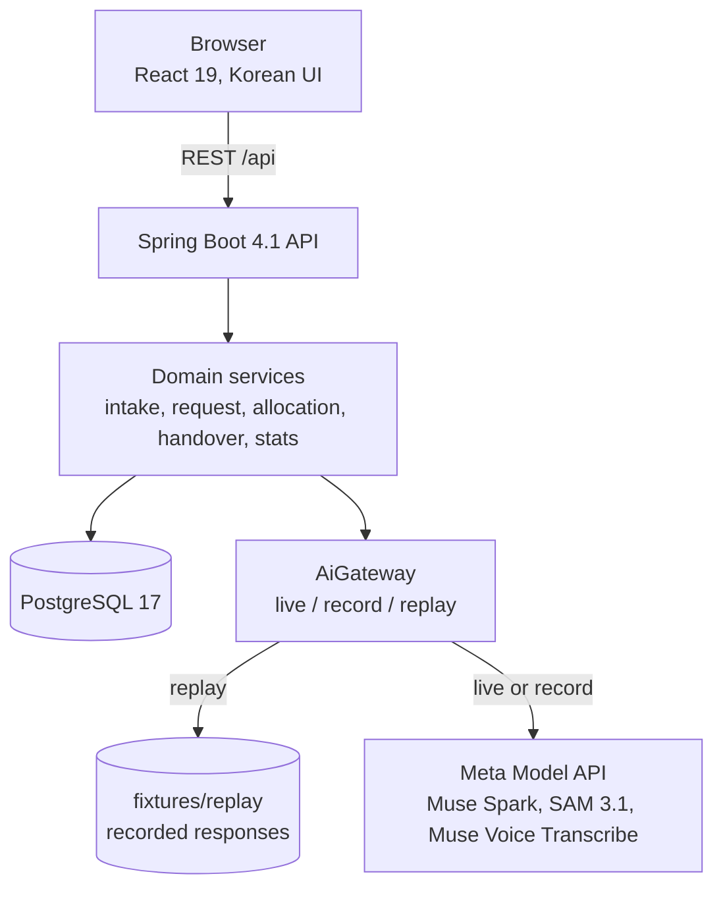

# AfterBooth

When a festival, exhibition or pop-up ends, the booth equipment (display racks, storage bins, folding tables) has to be cleared before the teardown deadline, often within hours. Whatever has no new owner by then gets thrown away. AfterBooth hands that equipment to the next event or group before the deadline.

Built for the Meta Global AI Developer Hackathon (Indie track) by a team of two. The UI is Korean and mobile first; this README and the rest of the repository are in English. The product spec is [`docs/SPEC.md`](docs/SPEC.md).

## How it works

1. **Photograph the booth.** The giver takes one photo. Muse Spark finds and counts each item, SAM 3.1 checks every box Spark drew, and the result becomes an inventory draft that a person corrects and confirms.
2. **Say what you need.** The receiver speaks or types a request, for example "display racks for a weekend event, I only have a sedan". Muse Voice Transcribe turns speech into text and Muse Spark turns it into structured conditions (category, quantity, vehicle, pickup time).
3. **Get an allocation.** A Muse Spark agent searches stock, checks whether the item fits the receiver's vehicle and places a temporary hold, all through server tools. When nothing fits, the person gets the server's alternatives, such as folding tables instead of a 180 cm rack that will not fit in a sedan.
4. **Race for the last item.** Two receivers can ask for the last display rack at the same moment. Exactly one hold succeeds; the other side sees an alternative.
5. **Hand over with a photo.** At pickup, one photo is recounted by Spark and checked by SAM 3.1. Only a matching count completes the handover; otherwise a person settles the difference.
6. **See what was reused.** Statistics show the reused count per category and per event, and the reused volume in liters from the items' registered sizes.

## Meta models in the product

Every AI call in the product goes to the Meta Model API through one gateway (`AiGateway`). No other model provider is used at runtime.

| Model | What it does | What its output leads to |
|---|---|---|
| Muse Spark | Finds and counts items in a booth photo with category, box, size and condition | An inventory draft, then inventory items after a person confirms |
| SAM 3.1 | Segments each item from Spark's boxes (box prompts); an item without a mask is flagged for review | Review flags on the draft; at handover, the gate that lets a recount complete |
| Muse Voice Transcribe | Transcribes a spoken pickup request (16 kHz mono WAV) | Text for Spark to structure |
| Muse Spark | Structures the request against a JSON schema | A saved pickup request |
| Muse Spark (function calling) | Runs the allocation agent with `searchCandidates`, `checkVehicleFit` and `holdQuantity` | A server-validated HOLD, never a confirmed reservation |
| Muse Spark | Recounts the reserved category in the handover photo | HANDED_OVER and the reuse statistics, or a mismatch for a person |

## AI proposes, the server decides

- The agent can only call the three tools above. The server executes every call, validates stock, the pickup deadline, the request's quantity, the category and the vehicle fit, and returns a typed rejection to the model when a call breaks a rule.
- The strongest state the agent can create is a HOLD. A person confirms it.
- The agent loop is bounded: at most 6 model turns within a 30-second agent-loop budget, at most 12 tool calls per model response and at most 3 rejected calls ([D-051](docs/DECISIONS.md)). If a model call fails before any HOLD, the run restarts once from the first turn ([D-057](docs/DECISIONS.md)).
- A handover never completes on the model's word alone: Spark's count must equal the reserved quantity and SAM 3.1 must segment every counted box ([D-032](docs/DECISIONS.md), [D-034](docs/DECISIONS.md)).

## Architecture



- `backend/`: Java 21, Spring Boot 4.1, Flyway migrations, `RestClient` to the Meta Model API behind `AiGateway`.
- `frontend/`: React 19, Vite, TypeScript, Tailwind v4. The API client and mocks are generated from [`contract/openapi.yaml`](contract/openapi.yaml), the API contract of record.
- The React build is served by Spring Boot, so one app container serves both the API and the UI ([D-056](docs/DECISIONS.md)).

## Concurrency and correctness

- **Stock never goes negative.** A hold decrements stock with a conditional update (`available_qty >= :q`). Zero affected rows means the hold failed. Cancel and expiry change the reservation status with a conditional update (`status = :expected`) and restore stock only when that update wins, so stock comes back exactly once.
- **One request, one quantity.** Holds for the same pickup request take the request row lock, so holds on different items never exceed the requested quantity, whether a person or the agent places them.
- **State machine.** `HELD → CONFIRMED → HANDED_OVER`, `HELD | CONFIRMED → RELEASED`, `HELD → EXPIRED`. Forbidden transitions are rejected. A scheduler expires holds past their TTL and releases confirmed reservations past the pickup deadline, and a confirm racing that expiry has exactly one winner.
- **Idempotency.** Every mutating request carries an `Idempotency-Key`. A repeat with the same body replays the stored response without running the action again; the same key with a different body is a conflict.
- **Crash recovery for idempotency keys** ([D-067](docs/DECISIONS.md)). A request holds a PostgreSQL session advisory lock on a dedicated connection for its whole lifetime, including AI preparation. If the process dies, PostgreSQL releases that lock, and a retry with the same key and body recovers the abandoned `IN_PROGRESS` record. While the original request is still running and holds its lock, a retry gets `IDEMPOTENCY_CONFLICT`. There is no age threshold and no background sweep, so recovery happens on a matching retry once the database has noticed the dead connection.

The required tests run against a real PostgreSQL in Testcontainers (`backend/src/test/java/com/afterbooth/ReservationIntegrationTest.java`):

1. 100 threads ask for the last 2 units, and exactly 2 succeed: `exactlyTwoOfOneHundredThreadsCanHoldLastTwoItems`.
2. Cancel and expiry restore stock exactly once: `cancelRestoresExactlyOnceAcrossConcurrentCalls`, `expiryRestoresExactlyOnceAndSchedulerReleasesMissedPickups`.
3. A repeated idempotency key never decrements twice: `repeatedKeyReplaysStoredResponseWithoutDecrementAndRejectsDifferentBody`.
4. Forbidden state transitions are blocked: `forbiddenTransitionsAreRejected`.
5. Agent tools cannot bypass server validation: `holdRulesRejectLateOversizedAndExcessQuantityForUserAndAgent`.
6. Concurrent holds on different items never exceed the request quantity: `differentItemsForSameRequestCannotExceedRequestQuantity`.
7. Confirm racing hold expiry has one winner and restores stock once: `confirmSampledBeforeExpiryLosesToSchedulerWithoutDoubleRestoration`, `schedulerSampledAfterExpiryLosesToConfirmWithoutRestoringStock`.

Idempotency crash recovery is covered by `IdempotencyRecoveryIntegrationTest`, which simulates a crash by terminating the test's own PostgreSQL lock session.

## Record, replay and live fallback

`AiGateway` runs in one of three modes (`AI_MODE`):

- **replay** (the default, and every automated test): answers from recorded responses in [`fixtures/replay/`](fixtures/README.md) without any network call or key. A fixture is keyed by the SHA-256 of the canonical, redacted request, so a request that was never recorded fails instead of getting a made-up answer.
- **record**: makes the live call once and stores the response; identical concurrent requests share one call.
- **live**: calls the Meta Model API. If a recorded answer exists for the same request and the live call fails or exceeds its window (Spark 8 s, SAM 5 s, Transcribe 6 s), the recorded answer is used and later recorded calls skip the network for 60 seconds ([D-057](docs/DECISIONS.md)). This keeps the stage demo running through a network drop between steps; a drop inside an intake or handover step fails that attempt, and the retry answers from the recording.

Because the key covers the exact request bytes, replay only answers the recorded demo inputs in the recorded order. New photos or recordings need live mode.

## Run it

Requirements: Docker only. No JDK, Node or Meta API key is needed.

```bash
docker compose up --build
```

The first build takes several minutes. When the log shows `Started AfterboothApplication`, open http://localhost:8080. The health endpoint confirms replay mode:

```bash
curl http://localhost:8080/api/health
```

It answers `{"aiMode":"replay","status":"UP"}`. This compose file pins replay mode and does not load any key file, so it never calls the Meta Model API and spends nothing.

### Try the recorded demo

Replay answers only these inputs, in this order, from an empty database ([`fixtures/README.md`](fixtures/README.md) §Demo scenario has every detail):

1. **Photo intake** (home page): upload `spike/samples/bins-orange-stack.jpg`. Wait for "수납함 4개" (4 storage bins) and press "재고로 등록" (register) once, without edits.
2. **Voice request** (`#/request`): choose "Community Makers", upload `spike/samples/audio-receiver-racks-sedan.wav` with "녹음 파일 올리기 (WAV)", press "픽업 요청 저장" (save), then "배정 제안 받기" (get a proposal). The 180 cm rack does not fit a sedan, so the screen offers alternatives. Do not pick one.
3. **Two-window race** (`#/request` in two windows): choose "Seoul Event Collective" in one and "Campus Festival Crew" in the other, type exactly `진열대 한 개가 필요해요. 밴으로 가져갈게요.` in both, press "입력한 내용 해석하기" (interpret) and "픽업 요청 저장" (save), then press "배정 제안 받기" in both. One window wins the last rack; the other gets an alternative.
4. In the winning window, press "진열대 예약 확정하기" (confirm the rack).
5. **Handover** (`#/handover`): select the confirmed reservation and upload `spike/samples/rack-gondola-single.jpg`. The recount matches one rack and completes the handover.
6. The statistics on the same screen show one reused display rack and its volume, 648 L.

To start again, delete the database and restart:

```bash
docker compose down -v
```

### Run the whole demo automatically

A Playwright test drives the same scenario through the real UI against a separate compose project on port 18080, including two browser contexts racing for the last rack ([`e2e/README.md`](e2e/README.md)). Requirements: Docker and Node 20 or later.

```bash
docker compose -p afterbooth-e2e-12 -f docker-compose.yml -f e2e/docker-compose.e2e.yml up --build -d
cd e2e
npm ci
npm run install-browsers
npx playwright test
cd ..
docker compose -p afterbooth-e2e-12 -f docker-compose.yml -f e2e/docker-compose.e2e.yml down -v
```

### Live mode

Live mode makes real, paid calls to the Meta Model API. A person opts in explicitly, by copying `.env.example` to `.env` and filling in the key, after the credit check in [`AGENTS.md`](AGENTS.md) (hard rule 6):

```bash
docker compose -f docker-compose.yml -f docker-compose.live.yml up --build
```

Developer commands (backend, frontend, tests) are in [`AGENTS.md`](AGENTS.md) §Commands.

## Measured so far

- One human-approved live run of the full scenario from a clean database: 19 AI calls, no fallback, photo to result in 6.4 s, the whole scenario in 38.2 s, about $0.04 ([`docs/TASKS.md`](docs/TASKS.md) #12, [`docs/BUDGET.md`](docs/BUDGET.md)). This is a single run (n = 1), not a benchmark.
- Total estimated Meta API spend for the project so far, including the Phase 0 spike: about $0.53, plus Muse Code usage whose billing was not measured ([`docs/BUDGET.md`](docs/BUDGET.md)).

## Development tools

The product's AI is Meta-only. The development work used three coding agents, all disclosed here:

- **Claude Code** and **Codex** wrote and reviewed most of the code under one rulebook, [`AGENTS.md`](AGENTS.md), with agent definitions in [`.claude/`](.claude) and [`.codex/`](.codex). Pull requests are reviewed by a Claude reviewer agent and Codex before a person merges them ([`docs/REVIEW_GUIDE.md`](docs/REVIEW_GUIDE.md)).
- **Muse Code** (Meta) reviewed and implemented parts of the core paths. Each use is logged with a `[Muse Code]` tag in [`docs/DECISIONS.md`](docs/DECISIONS.md):
  - D-024: review of the API contract.
  - D-052: review of the allocation agent ([screenshot](docs/evidence/muse-allocation-review.png)).
  - D-061 and D-062: implementation and review of strict quantity parsing for handover and holds.
  - D-066: review of the photo intake path ([output rendering](docs/evidence/muse-intake-review.png)).

## Repository map

- [`docs/SPEC.md`](docs/SPEC.md): product requirements and the demo scenario.
- [`contract/openapi.yaml`](contract/openapi.yaml): the API contract. [`docs/ERD.md`](docs/ERD.md): the data model.
- [`docs/DECISIONS.md`](docs/DECISIONS.md): every design decision, numbered. [`docs/TASKS.md`](docs/TASKS.md): progress, verification records and the self-score.
- [`fixtures/`](fixtures/README.md): recorded AI responses for replay. [`spike/REPORT.md`](spike/REPORT.md): the Phase 0 model spike.
