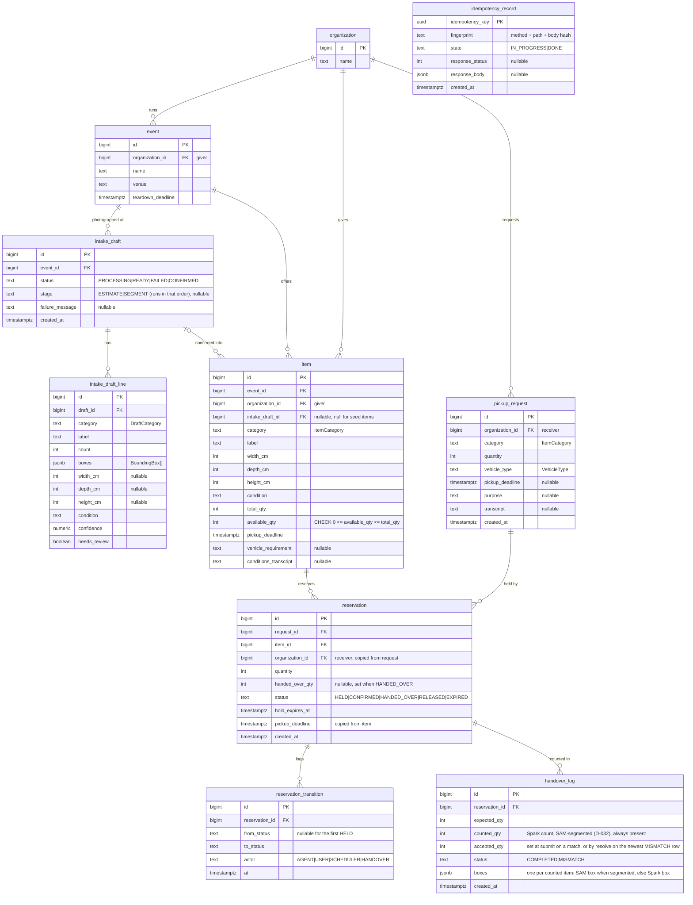
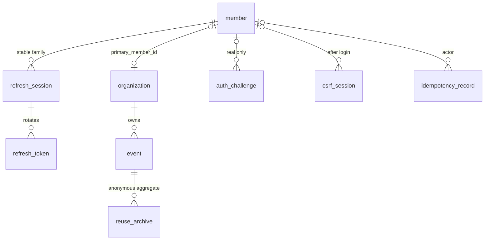

# ERD — AfterBooth data model

The database shape of record. It is derived from `contract/openapi.yaml` and `docs/SPEC.md`; if they disagree, fix this file in the same PR as the contract change. Entities in code follow `docs/CONVENTIONS.md` (behavior on entities, other aggregates by ID).

## Rules the schema must keep

| Rule | Where it is enforced |
|---|---|
| `available_qty` never goes below 0 or above `total_qty` | `CHECK` constraint + conditional `UPDATE ... WHERE available_qty >= :q AND :q > 0` |
| `available_qty = total_qty − Σ(HELD, CONFIRMED quantity) − Σ(HANDED_OVER handed_over_qty)` | Every status change and its quantity effect happen in one transaction |
| A reservation's status changes only along the table in `ReservationStatus` (contract) | `Reservation` entity methods + a conditional `UPDATE ... WHERE status = :expected` so confirm and expiry cannot both win |
| Each request's active quantity ≤ `pickup_request.quantity` | `SELECT ... FROM pickup_request WHERE id = :id FOR UPDATE` first, then sum active reservations and insert, all in one transaction. Both `holdItem` and the agent's `holdQuantity` take this lock, so concurrent holds on different items for one request are serialized |
| One allocation run per request while it has an active reservation | Checked inside the same `pickup_request` row lock (REQUEST_ALREADY_HELD), so a concurrent second run for the same request gets 409 |
| A handover completes only after a completed photo recount: Spark completed, and SAM 3.1 completed unless Spark counted zero (a failed call writes no row) | `resolveHandover` requires the newest `handover_log` row for the reservation to be MISMATCH; `counted_qty` is NOT NULL |
| Same Idempotency-Key never runs twice | `idempotency_record` row inserted first (`IN_PROGRESS`), response stored on `DONE` |

## Notes

- **Reuse stats are a query, not a table.** `getReuseStats` sums `reservation.handed_over_qty` for HANDED_OVER reservations, grouped by item category and event, and `handed_over_qty × width_cm × depth_cm × height_cm` of their items as liters, rounded down (D-064). SPEC's "ReuseStat" is this read model.
- **Allocation runs are not stored.** A same-key retry replays the response kept in `idempotency_record`; holds are re-read from `reservation`.
- **Labels are not stored for lookups.** `item.label` is written from the category table in the contract (`ItemCategory`) at confirm time, and stats labels use the same table.
- **Times are `timestamptz`.** The API returns them with the +09:00 offset (`docs/DECISIONS.md` D-019).
- **Enums are `text` columns** mapped with `@Enumerated(EnumType.STRING)`, so values match the contract strings exactly.
- **Seed data** (organizations, one event, demo items) lives in a Flyway migration so every environment, including Testcontainers, starts the same.

## Migrations

- Version with a timestamp so parallel branches never collide: `V202610311200__create_core_tables.sql` (`V` + `yyyyMMddHHmm`).
- The authentication foundation is implemented in `backend/src/main/resources/db/migration/V202611031200__create_member_authentication_foundation.sql`. This documentation correction does not change the SQL.
- #3 creates every table above in one migration. Later changes add new migrations; merged migrations are never edited.

## Member authentication schema target (#63 design, #65 implementation)

This is the **authentication schema target** from D-069–D-075 and [Member authentication design](AUTH_DESIGN.md). #65 implements this additive schema in a new Flyway migration (D-076), preserving the original core migration and existing rows. Schema availability does not implement later login/session/withdrawal/domain-authorization orchestration. Current verification evidence belongs in TASKS; the original #63 design did not apply SQL.

### New tables and constraints

| Table | Columns and keys | Invariants and cleanup |
|---|---|---|
| `member` | id bigint identity PK; email_normalized varchar(254) nullable; password_hash text nullable; state text; auth_version bigint NOT NULL default 0; created_at timestamptz; verified_at timestamptz nullable; withdrawn_at timestamptz nullable; purge_after timestamptz nullable | States: PENDING_VERIFICATION/ACTIVE/WITHDRAWN. All non-NULL email_normalized values are UNIQUE. Only withdrawn members have NULL email/password; withdrawn_at is required and purge_after=withdrawn_at+30 days. Other states require email/hash. ACTIVE requires verified_at. Delete unverified registrations after 24 hours |
| `withdrawn_email_block` | email_hmac bytea; key_version text; blocked_until timestamptz; PK(key_version,email_hmac) | No member/organization FK or raw email. Delete 30 days after withdrawal; do not block when now>=blocked_until. Compare the normalized email under every still-valid key version |
| `refresh_session` | id uuid PK; member_id bigint FK member; auth_version bigint; created_at timestamptz; expires_at timestamptz; revoked_at timestamptz nullable | One row is the family for one device login. JWT sid is this ID and remains stable through refresh rotation. expires_at=created_at+7 days. Check member ACTIVE state, version, revocation and expiry together |
| `refresh_token` | token_hash bytea PK; session_id uuid FK refresh_session; created_at timestamptz; used_at timestamptz nullable | Store SHA-256, never raw CSPRNG tokens. At most one unused token per session (partial UNIQUE where used_at IS NULL). Lock the family row before marking the old token used and inserting its replacement. Reuse of a used hash revokes the family. Preserve used hashes until family expiry, then cascade cleanup |
| `auth_challenge` | id text PK; member_id bigint nullable FK member; email_key bytea; key_version text; purpose text; code_hmac bytea nullable; attempts int; created_at timestamptz; expires_at timestamptz; consumed_at timestamptz nullable | Random 256-bit ID. Purpose SIGNUP_VERIFY/PASSWORD_RESET; attempts 0..5; lifetime 10 minutes. email_key is a purpose-specific HMAC of the normalized email. Dummy challenges have NULL member_id/code_hmac with the same issuance/attempt limits. Allow only one valid challenge per purpose. Bind the code HMAC to id/purpose/email. Consumed/expired challenges are unusable; delete within one hour after expiry |
| `csrf_session` | id_hash bytea PK; token_hash bytea; member_id bigint nullable FK member; created_at timestamptz; expires_at timestamptz | Hash the separate random cookie ID and synchronizer token. Absolute lifetime one hour; replace on login. Anonymous sessions are allowed. Delete member-linked rows on withdrawal, logout-all and password change/reset. Clean up within one hour after expiry |
| `auth_rate_limit` | scope text; subject_hmac bytea; key_version text; window_start timestamptz; count int; expires_at timestamptz; PK(scope,subject_hmac,key_version,window_start) | Store no raw email/IP. Separate purpose, API and failure scopes. Require atomic increments and multi-instance consistency. Delete within one hour after the window ends. Check previous keys for live windows so key rotation does not reset limits |
| `reuse_archive` | event_id bigint FK event; category text; reused_qty bigint NOT NULL; reused_volume_cm3 numeric(38,0) NOT NULL; PK(event_id,category) | No personal/member/reservation IDs, raw text or individual processing timestamps. Existing category enum only; totals >=0. Aggregate in the same transaction as detailed reservation deletion to prevent double counting on retry. Preserve only sanitized event/organization shells needed by statistics FKs |

Commit authentication failures consistently, including attempt-counter updates. Email uniqueness checks, withdrawal-block insertion and re-registration use the same DB transaction lock key for a normalized email; keep its lock identity stable across key rotation. UNIQUE errors do not replace the blocking-period check. Use one DB clock value for now. Do not put keys, actual hashes or emails in documentation or fixtures.

### Existing table extensions and transition

| Target | Planned change | Existing data |
|---|---|---|
| `organization` | primary_member_id bigint nullable UNIQUE FK member ON DELETE SET NULL | Preserve NULL for existing rows. Create a dedicated organization on registration; never inherit seed ownership automatically or copy email into the organization name. Shared organizations are out of scope |
| `reservation` | retention_until timestamptz nullable | NULL before withdrawal. When either party withdraws, use the earlier of the existing deadline and withdrawn_at+30 days. HELD/CONFIRMED are not cleanup candidates because they block withdrawal |
| `item` | archived_handed_over_qty int NOT NULL default 0 CHECK >=0 | Existing rows start at 0. Accumulate handed-over quantity when deleting HANDED_OVER details. total_qty >= archived_handed_over_qty. Exclude withdrawn members' items from new transactions and public listings |
| `idempotency_record` | actor_member_id bigint nullable FK member; related_organization_ids bigint[] NOT NULL default '{}' | Disable replay and clean up pre-authentication responses at rollout. Bind new fingerprints to the server principal while preserving globally UNIQUE keys. New writes require an actor. Record every giver/receiver organization appearing in the response; never derive this list from unchecked client input |

Replay `idempotency_record` only **after** authentication, object authorization and actor matching succeed. Another member submitting the same key must not receive the stored response. Do not guess owners for legacy anonymous rows. Track every organization in multi-reservation allocation responses with related_organization_ids; withdrawal deletes raw responses/fingerprints linked to that organization. Existing domain-state checks prevent duplicate execution with new keys on active transactions. Replay is not guaranteed after raw responses are deleted; new requests must recheck current authorization and resources first.

The new inventory invariant is `available_qty = total_qty − archived_handed_over_qty − Σ(HELD, CONFIRMED quantity) − Σ(HANDED_OVER handed_over_qty)`. Preserve all other quantity constraints, state transitions and request-level active-quantity limits. Statistics combine surviving HANDED_OVER rows with reuse_archive. Accumulate exact `handed_over_qty × width_cm × depth_cm × height_cm` in cm³ without truncation; add the remaining raw cm³ and divide by 1000, rounding down only at the end. Two 600cm³ transactions purged separately must still total one liter. Aggregates contain neither individual processing timestamps nor members.

Exclude expired records from reads and remove the originals within one hour. Delete handover_log → reservation_transition → reservation, then unreferenced drafts/requests/items/events/organizations/members of the withdrawn member. Do not delete an active counterparty's other transactions. Preserve sanitized event/organization shells referenced by archive and remove their member FKs. Do not disable FK/inventory constraints or adjust totals without accounting for history.

Implementation and migration tests must cover member-state constraints, email uniqueness, 30-day boundaries, preservation of NULL ownership, refresh rotation, withdrawal/HOLD races, and inventory/statistics invariants after cleanup. This design task did not execute migrations or DB validation.

Authenticated password change (D-075) reuses member.password_hash/auth_version, refresh_session/refresh_token, auth_challenge, csrf_session and auth_rate_limit; it adds no tables or columns. Serialize final credential checks, session issuance and credential changes using the member row. Changing/resetting a password invalidates all outstanding PASSWORD_RESET challenges and member-linked CSRF sessions in the same transaction as the hash/version change and session revocation. Use a distinct rate-limit scope for password-change failures; failed attempts must persist even though the password mutation is rejected.
